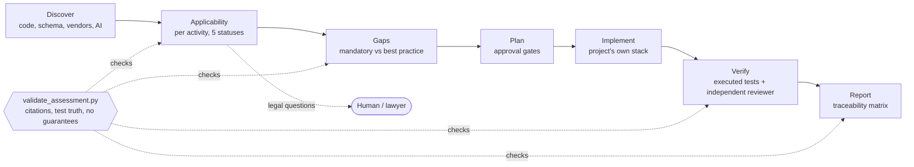

# DPDP Act compliance engineering skill for AI coding agents

**An open-source Claude Code / agent skill for India's Digital Personal Data Protection (DPDP) Act, 2023 and DPDP Rules, 2025. It checks whether the Act applies to your code, finds privacy gaps, implements fixes, and verifies them with tests.**

[](https://github.com/annjan777/dpdp-compliance-engineering/actions/workflows/ci.yml) · [Apache-2.0](LICENSE) · [Results](benchmark/RESULTS.md) · [Contributing](CONTRIBUTING.md) · [Security](SECURITY.md)

> **Not legal advice.** This is an engineering aid. It never certifies compliance, and legal conclusions need review by a qualified lawyer.

### The problem

Teams building for Indian users have until **13 May 2027** before most DPDP duties take effect. The duties cover consent, notice, erasure, breach reporting and children's data. An AI coding agent asked to "make this DPDP compliant" usually starts adding consent banners. It skips the first question: does the Act even apply to what this code does?

### What it does

```text
You: Does DPDP apply to this repo? Assess it and fix what's needed.

Agent (with this skill):
  Applicability: applicable (medium confidence). "Internal portal" is not an exemption.
                 Duties apply from 2027-05-13 (not yet in force).
  Gaps:  F-01 critical  get_appointments() lets any user read any patient's symptoms  clinic/app.py:58
         F-03 high      email + symptom text sent to an overseas analytics vendor      clinic/app.py:54
         ... 9 more, mandatory obligations kept separate from best practice
  Legal questions for a lawyer: 9 (e.g. is a public university "State" under Act s.17(4)?)
  Implemented: 8 changes. Tests: 23 passed. Independent review found 11 more issues, all fixed or filed.
```

This is condensed from the real worked example in [`examples/campus-clinic`](examples/campus-clinic). The [`pocket-ledger`](examples/pocket-ledger) example shows the opposite result: an app the Act does **not** apply to, where the skill adds no compliance machinery.

### Quick start

```bash
git clone https://github.com/annjan777/dpdp-compliance-engineering ~/.claude/skills/dpdp-compliance-engineering
```

Then, in Claude Code inside your project, ask: *"Does DPDP apply to this repo? Assess it."* Other install options are under [Install](#install).

### How it differs

- **Applicability before obligations.** It assesses each processing activity, with five possible statuses. "Not applicable" is a valid, evidence-backed answer.
- **Citation discipline.** A validator rejects provisions that don't exist, test passes that never ran, and phrases like "fully compliant".
- **Measured, including where it falls short.** See [benchmark/RESULTS.md](benchmark/RESULTS.md): it helps with handling legal uncertainty, and showed no detection benefit on an easy benchmark.

## How it works



Every phase writes to one shared record, `.dpdp/assessment.yaml`, so several agents can split the work without losing evidence. A validator checks the record after each phase.

## What's inside

```
dpdp-compliance-engineering/
├── SKILL.md                         # entry point: workflow A–G, rules, file map
├── references/                      # loaded on demand
│   ├── legal-sources.md             # citation registry, commencement, what the law does NOT say
│   ├── requirements-catalog.yaml    # 40 IDs (5 scope gates, 35 obligations): triggers, exceptions, evidence, tests
│   ├── applicability-method.md      # 9-gate procedure, five statuses, roll-up rules
│   ├── discovery-guide.md           # stack-agnostic discovery, AI systems, data-flow maps
│   ├── engineering-patterns.md      # 11 control patterns + anti-patterns
│   ├── verification-guide.md        # test matrix + independent verifier checklist
│   └── multi-agent-protocol.md      # 5 roles, ownership, trust rules, hand-offs
├── assets/
│   ├── templates/                   # shared assessment.yaml, project config, 6 human-readable templates
│   └── agents/                      # optional subagent definitions for the 5 roles
├── scripts/
│   ├── scan_personal_data.py        # heuristic discovery signals (stdlib only)
│   ├── validate_assessment.py       # mechanical guard rails (needs PyYAML for .yaml)
│   ├── render_report.py             # 12-section report + traceability matrix
│   └── tests/                       # pytest suite for the guard rails
├── examples/
│   ├── pocket-ledger/               # outside scope: local-only CLI (s.3(c)(i)), security fix only
│   └── campus-clinic/               # in scope: built assuming "internal = exempt"; 6 changes implemented and tested
└── evals/                           # 5 behavioural test cases (claude plugin eval format; not packaged)
```

## Measured results (pilot)

See `benchmark/RESULTS.md`. In short, on `claude-opus-5-5`:
- **Behavioural cases (LLM-graded, 15 runs per arm):** 0.97 with the skill vs 0.78 without. The gap is mostly in handling legal uncertainty and reporting.
- **12-case deterministic benchmark:** 0.984 with the skill vs 1.000 without. That is no detection benefit; the cases are too easy.
- Small samples, synthetic fixtures, and the author wrote the tests.

## Install

**Claude Code (one user, all repos):** clone or copy the folder to `~/.claude/skills/dpdp-compliance-engineering/`.

**Claude Code (one repo, shared with the team):** commit it to `<repo>/.claude/skills/dpdp-compliance-engineering/`.

**Subagents (optional):** copy `assets/agents/*.md` to `~/.claude/agents/` or `<repo>/.claude/agents/`. You get `dpdp-discovery`, `dpdp-legal-mapping`, `dpdp-privacy-engineer`, `dpdp-implementer` and `dpdp-verifier`.

**claude.ai / Claude apps:** download `dpdp-compliance-engineering.skill` from the [latest release](https://github.com/annjan777/dpdp-compliance-engineering/releases/latest) and upload it under Settings → Capabilities → Skills.

**Other agent platforms:** the skill is plain Markdown, YAML and Python 3. Point the agent at `SKILL.md` as its instructions. The scripts need only Python 3.9+ and PyYAML (`pip install pyyaml`).

## Invoke

Ask naturally. The description triggers on DPDP, Indian data protection, privacy compliance, consent, erasure and similar requests. For example:

- "Does DPDP apply to this repo? Assess it and fix what's needed."
- "Reassess .dpdp/assessment.yaml after the new analytics vendor was added."
- "/dpdp-compliance-engineering" (explicit, where slash invocation is supported)

Per-project state lives in the target repo under `.dpdp/`:

- `config.yaml`: your decisions;
- `assessment.yaml`: the shared record;
- `scan.json`, `report.md`, `runs/`.

The skill itself holds no project data, so one copy serves every repository.

## Multi-agent use

One agent can run all phases. To split the work, assign the five roles in `references/multi-agent-protocol.md`:

- each role owns specific sections of `.dpdp/assessment.yaml`;
- evidence written by another agent counts as `agent-claim` until re-checked;
- only humans close legal questions;
- the verifier must be a different agent than the implementer.

`validate_assessment.py` runs at every hand-off.

## Validate the skill

```bash
cd dpdp-compliance-engineering
python3 -m pytest -q scripts/tests                     # guard-rail tests
python3 scripts/validate_assessment.py examples/pocket-ledger/.dpdp/assessment.yaml --strict
python3 scripts/validate_assessment.py examples/campus-clinic/.dpdp/assessment.yaml --strict
(cd examples/campus-clinic && python3 -m pytest -q)    # worked example's own tests
(cd examples/pocket-ledger && python3 -m pytest -q)
```

**Behavioural evals** (real model runs, Claude Code ≥ v2.1.269): `claude plugin eval . --allow-tools Write,Edit,Bash --scaffold`.

**Format check** (if the skill-creator skill is available): `python -m scripts.quick_validate <path-to-skill>` from the skill-creator directory.

## Keeping it current

`references/legal-sources.md` was last reviewed on 2026-10-29. When MeitY or the Board issues anything new, update the registry and the catalog together, and bump `catalog_version`. Typical examples: amended Rules, an SDF designation, a s.16 restricted-country list, s.17 exemption notifications, or Board guidance. The validator derives `in_force` from the catalog's commencement dates, so assessments re-checked after 13 May 2027 will flag stale entries automatically.
