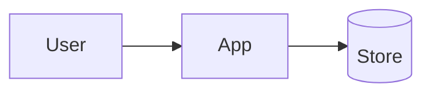

# Personal-data inventory and data-flow map — {{project.name}}

Legend: **C** = confirmed (evidence cited) · **A** = assumed · **U** = unknown

## Components
| ID | Type | Technology | Location/region | Evidence | C/A/U |
|---|---|---|---|---|---|

## Data subjects
| ID | Who | May include minors? | Evidence |
|---|---|---|---|

## Data categories
| ID | Category | Example fields (names only) | Subjects | Stored in | Evidence | C/A/U |
|---|---|---|---|---|---|---|

## Processing activities
| ID | Activity | Purpose | Data | Subjects | Components | Recipients | Location | Ground candidate | Current retention | Evidence | C/A/U |
|---|---|---|---|---|---|---|---|---|---|---|---|

## Vendors / processors
| ID | Vendor | Role | Region | Data shared | Contract | Erasure method | Evidence |
|---|---|---|---|---|---|---|---|

## Logging, analytics, backups, exports, AI
| Item | What personal data | Where | Retention | Evidence |
|---|---|---|---|---|

## Data-flow map

## Assumptions and unknowns
| ID | Text | Affects | Confirm with |
|---|---|---|---|
