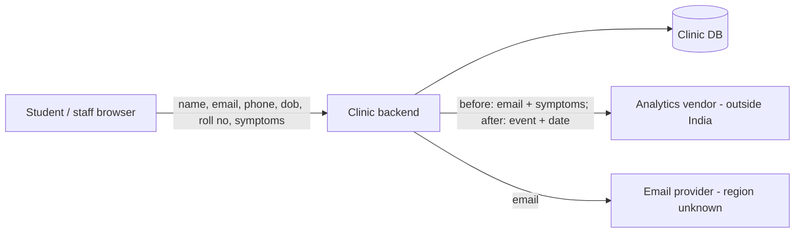

# DPDP engineering assessment report — Campus Clinic Appointments

> Engineering assessment, not legal advice. Legal conclusions require qualified review. This report records what was inspected, changed and tested. It does not certify legal compliance.

Assessment date: 2026-10-29 · Repo ref: 7145e53 (assessed); f52e15c (changes); e5c1c42 + aa43327 (review round 1 fixes); c8a150c (round 2 fixes) · Assessed by: discovery, legal-mapping, privacy-engineering, implementation, independent-verification

## 1. Application overview

Internal portal of a publicly funded university's health centre. Students and staff register, book appointments with symptoms, and may subscribe to a health newsletter.

Scope of assessment: Whole repository at 7145e53 (clinic/, tests/). Not inspected: hosting, backups, the email provider integration beyond the stub, vendor contracts.

**Components**

| ID | Type | Tech | Location |
|---|---|---|---|
| C-01 | backend | Python, sqlite3 (stdlib) | clinic/app.py |
| C-02 | db | SQLite schema (production DB engine unknown) | clinic/app.py:init_db |
| C-03 | vendor | HTTP analytics API | outside India (us-east-1 per comment) |
| C-04 | vendor | email provider | unknown |

**Processing activities**

| ID | Activity | Purpose | Data | Recipients | Location | Facts |
|---|---|---|---|---|---|---|
| PA-01 | Appointment booking and records | Book and manage clinic appointments | DC-01, DC-02 | V-01 | India (assumed, A-01) | confirmed |
| PA-02 | Health newsletter | Send health-awareness newsletter | DC-01, DC-03 | V-02 | unknown | confirmed |
| PA-03 | Usage analytics | Measure booking volumes | DC-01, DC-02 | V-01 | outside India | confirmed |
| PA-04 | Staff accounts | Clinician access to patient records | DC-01 |  | India (assumed, A-01) | confirmed |

**Data-flow map**

## 2. Applicability assessment and limitations

**Overall: applicable** (confidence: medium; legal review required: True)

All four activities process digital personal data of identifiable students and staff in India for purposes the health centre decides (PA-01..PA-04). 'Internal portal' (E-001) is not an exclusion or exemption under Act s.3(c) or s.17. Substantive obligations commence on 2027-05-13. Confidence is medium because the State-instrumentality question (Q-02) can remove some erasure duties and the lawful ground for bookings (Q-05) is unconfirmed.

| Activity | Status | Lawful ground | Provisions | Confidence | Reasoning |
|---|---|---|---|---|---|
| PA-01 | applicable | s.7(a) candidate (Q-05) | Act s.2(t), Act s.3(a), Act s.7(a) | medium | Students voluntarily provide data to book appointments; health data is ordinary personal data under the Act. The team's 'internal' claim (E-001) does not match any exclusion. |
| PA-02 | applicable | consent | Act s.4, Act s.6(1) | medium | Newsletter is not needed for the service, so consent is the only fitting ground. A pre-ticked default does not meet the s.6(1) affirmative-action standard for new consents; how existing pre-commencement opt-ins are treated under s.5(2) is open (Q-09). |
| PA-03 | applicable | unknown | Act s.8(1), Act s.8(2), Act s.16 | medium | Identifiable health data was sent abroad to a vendor with unknown role and contract. |
| PA-04 | applicable | s.7(i) | Act s.7(i), Act s.8(5) | high | Employment-related processing: lawful without consent, but general duties (security, retention) remain. |

**Assumptions and unknowns (limitations)**

| ID | Text | Affects |
|---|---|---|
| A-01 | Backend and database are hosted in India (no infra code in repo) | PA-01, PA-04 |
| U-01 | Whether any student users are under 18 | DS-01, PA-01, PA-02, DPDP-CHD-01, DPDP-CHD-02 |
| U-02 | Contracts with analytics and email vendors | V-01, V-02, DPDP-FID-01, DPDP-SEC-06 |
| U-03 | Backup configuration and retention | DPDP-SEC-04, DPDP-RET-01 |

## 3. Legal requirements considered and supporting evidence

| Req ID | Title | Provisions | Status | In force | Evidence | Required action |
|---|---|---|---|---|---|---|
| DPDP-LAW-01 | Every purpose has a lawful ground (consent or a specific legitimate use) | Act s.4 | applicable | no (from 2027-05-13) | E-008 | Processing register with ground per purpose (clinic/register.py added; PA-03 ground open) |
| DPDP-LAW-02 | Legitimate-use conditions are actually met | Act s.7, Rules r.5, Rules Sch.2 | potentially-applicable | no (from 2027-05-13) | E-002 | Confirm s.7(a) for bookings or switch to consent |
| DPDP-NOT-01 | Notice accompanies or precedes every consent request | Act s.5(1), Rules r.3 | applicable | no (from 2027-05-13) | E-008 | Versioned notice shown before newsletter consent |
| DPDP-NOT-02 | Notice to users who consented before commencement | Act s.5(2) | applicable | no (from 2027-05-13) | E-003 | Legacy subscribers: s.5(2) notice; whether re-confirmation is needed depends on Q-09 |
| DPDP-NOT-03 | Language option for notice and consent request | Act s.5(3), Act s.6(3) | applicable | no (from 2027-05-13) | E-008 | Language options for the notice |
| DPDP-CON-01 | Valid consent (affirmative, specific, unbundled, necessary data only) | Act s.6(1), Act s.6(2) | applicable | no (from 2027-05-13) | E-003 | Default-off, per-purpose consent |
| DPDP-CON-02 | Contact details in the consent request | Act s.6(3), Act s.8(9), Rules r.9 | applicable | no (from 2027-05-13) | E-008 | Show contact at consent (with P-06 UI) |
| DPDP-CON-03 | Withdrawal as easy as giving consent; processing and processors stop | Act s.6(4), Act s.6(5), Act s.6(6) | applicable | no (from 2027-05-13) | E-008 | Withdrawal + gate at send time |
| DPDP-CON-04 | Provable notice and consent records | Act s.6(10) | applicable | no (from 2027-05-13) | E-003 | Consent ledger with notice version |
| DPDP-CON-05 | Consent Manager integration (only if used) | Act s.6(7), Act s.6(8), Act s.6(9), Rules r.4, Rules Sch.1 | not-currently-applicable | no (from 2026-11-13) | E-011 | none |
| DPDP-FID-01 | Processors engaged only under a valid contract; fiduciary stays responsible | Act s.8(1), Act s.8(2), Rules r.6(1)(f) | applicable | no (from 2027-05-13) | E-005, E-013 | Vendor register; contracts; payload minimisation |
| DPDP-FID-02 | Accuracy where data drives decisions or is disclosed | Act s.8(3) | applicable | no (from 2027-05-13) | E-002 | Correction path for clinical records (with RGT-03) |
| DPDP-SEC-01 | Protect data by encryption, obfuscation, masking or virtual tokens | Act s.8(5), Rules r.6(1)(a) | applicable | no (from 2027-05-13) | E-002 | At-rest protection for symptoms; confirm TLS and DB encryption |
| DPDP-SEC-02 | Access control to computer resources | Act s.8(5), Rules r.6(1)(b) | applicable | no (from 2027-05-13) | E-006 | Object-level authorisation |
| DPDP-SEC-03 | Logging, monitoring and review of access to detect unauthorised access | Act s.8(5), Rules r.6(1)(c), Rules r.6(1)(e) | applicable | no (from 2027-05-13) | E-008 | Processing/access log without copied personal data; monitoring |
| DPDP-SEC-04 | Continuity of processing (backups and recovery) | Act s.8(5), Rules r.6(1)(d) | potentially-applicable | no (from 2027-05-13) |  | Confirm backups and restore test |
| DPDP-SEC-05 | Retain logs and personal data for one year for detection and investigation | Rules r.6(1)(e), Rules r.8(3), Rules Sch.7 | applicable | no (from 2027-05-13) | E-007 | Keep processing logs >= 1 year even after erasure; purge after |
| DPDP-SEC-06 | Security provisions in processor contracts | Act s.8(5), Rules r.6(1)(f) | applicable | no (from 2027-05-13) | E-005, E-013 | Security clauses in vendor contracts |
| DPDP-BRE-01 | Notify each affected Data Principal of a breach | Act s.8(6), Rules r.7(1) | applicable | no (from 2027-05-13) | E-008 | Incident runbook and user notice template |
| DPDP-BRE-02 | Notify the Board without delay and give a detailed report within 72 hours | Act s.8(6), Rules r.7(2) | applicable | no (from 2027-05-13) | E-008 | Incident record with 72h Board deadline |
| DPDP-RET-01 | Erase on withdrawal or when the purpose is served, including at processors | Act s.8(7) | applicable | no (from 2027-05-13) | E-007 | Erasure cascade incl. processors; retention rule for medical records |
| DPDP-RET-02 | Three-year inactivity erasure with 48-hour notice (Sch.3 classes only) | Act s.8(8), Act s.8(11), Rules r.8(1), Rules r.8(2), Rules Sch.3 | not-currently-applicable | no (from 2027-05-13) | E-002 | none |
| DPDP-GRV-01 | Publish a contact person for processing questions | Act s.8(9), Rules r.9 | applicable | no (from 2027-05-13) | E-008 | Publish contact; include in responses |
| DPDP-GRV-02 | Grievance redressal within the published period (at most 90 days) | Act s.8(10), Act s.13, Rules r.14(3) | applicable | no (from 2027-05-13) | E-008 | Grievance intake with due date <= 90 days |
| DPDP-CHD-01 | Verifiable parental consent before processing a child's data | Act s.2(f), Act s.9(1), Rules r.10 | potentially-applicable | no (from 2027-05-13) | E-002 | Decide whether minors are possible; if so parental consent for PA-02 and Sch.4 analysis for PA-01 |
| DPDP-CHD-02 | No tracking, behavioural monitoring or targeted ads directed at children; no detrimental processing | Act s.9(2), Act s.9(3), Rules r.12, Rules Sch.4 | potentially-applicable | no (from 2027-05-13) | E-005 | No tracking of child accounts |
| DPDP-CHD-03 | Lawful guardian verification for persons with disability | Act s.2(j), Act s.9(1), Rules r.11 | not-currently-applicable | no (from 2027-05-13) | E-011 | none |
| DPDP-SDF-01 | Significant Data Fiduciary obligations | Act s.10, Rules r.13 | not-currently-applicable | no (from 2027-05-13) |  | none |
| DPDP-RGT-01 | Publish how to exercise rights and the identifiers needed | Rules r.14(1), Rules r.14(2), Rules r.14(5) | applicable | no (from 2027-05-13) | E-008 | Publish rights page |
| DPDP-RGT-02 | Access right (summary of data, processing, and recipients) | Act s.11 | applicable | no (from 2027-05-13) | E-008 | Access summary |
| DPDP-RGT-03 | Correction, completion, updating and erasure on request | Act s.12 | applicable | no (from 2027-05-13) | E-007 | Correction and erasure requests |
| DPDP-RGT-04 | Nomination | Act s.14, Rules r.14(4) | applicable | no (from 2027-05-13) | E-008 | Nomination procedure |
| DPDP-XB-01 | Cross-border transfer restrictions | Act s.16, Rules r.15, Rules r.13(4) | applicable | no (from 2027-05-13) | E-005 | Check notifications and health-sector rules for the US transfer |
| DPDP-GOV-01 | Handling Central Government information requests | Act s.36, Rules r.23, Rules Sch.7 | applicable | no (from 2027-05-13) | E-008 | Runbook naming owner |

## 4. Identified gaps

Mandatory = legal gap against an applicable requirement. Everything else is a security, operational or optional improvement.

| ID | Req | Category | Mandatory | Severity | Priority | Title | Status |
|---|---|---|---|---|---|---|---|
| F-01 | DPDP-SEC-02 | legal-gap | True | critical | P0 | Any user can read any user's appointments (IDOR) | verified |
| F-13 | DPDP-SEC-02 | legal-gap | True | critical | P0 | Erased user ids were reused, attaching retained records and consent to the next new user | verified |
| F-02 |  | security-vulnerability | False | high | P1 | Name, email and phone written to application logs | verified |
| F-03 | DPDP-FID-01 | legal-gap | True | high | P1 | Email and symptom text sent to an overseas analytics vendor with unknown contract | implemented |
| F-04 | DPDP-CON-01 | legal-gap | True | medium | P1 | Newsletter consent is pre-ticked and stored as an overwritable boolean | verified |
| F-06 | DPDP-RET-01 | legal-gap | True | high | P1 | Account deletion leaves data behind and never reaches the vendor | verified |
| F-08 | DPDP-SEC-01 | legal-gap | True | high | P1 | Symptom text stored unprotected at rest | planned |
| F-14 | DPDP-RET-01 | legal-gap | True | high | P1 | Vendor erasure request used an id the vendor never received; email provider not notified | verified |
| F-15 |  | security-vulnerability | False | high | P1 | Any caller could erase any account; log recorded the wrong actor | verified |
| F-05 | DPDP-NOT-01 | legal-gap | True | medium | P2 | No notice before consent | in-progress |
| F-07 | DPDP-RGT-02 | legal-gap | True | low | P2 | No access summary | verified |
| F-09 | DPDP-BRE-02 | legal-gap | True | medium | P2 | No breach detection or notification process | planned |
| F-10 | DPDP-GRV-02 | legal-gap | True | medium | P2 | No grievance channel or published contact | planned |
| F-11 | DPDP-NOT-02 | legal-gap | True | medium | P2 | Existing pre-ticked subscribers need a notice; re-confirmation depends on Q-09 | planned |
| F-16 | DPDP-RGT-02 | legal-gap | True | medium | P2 | Access summary open to clinicians and listed recipients the user's data never reached | verified |
| F-17 | DPDP-SEC-05 | legal-gap | True | medium | P2 | Processing-log purge exists but is never scheduled; log sits in the primary DB | planned |
| F-20 |  | security-vulnerability | False | medium | P2 | Erasure sent non-subscribers' email addresses to the email provider | verified |
| F-12 |  | best-practice | False | low | P3 | Offer a downloadable copy of a user's data | open |
| F-18 |  | operational-weakness | False | low | P3 | Erasure fails with foreign keys enforced; registration left half-created rows on consent error | in-progress |
| F-19 | DPDP-SEC-03 | legal-gap | True | low | P3 | Denied access attempts are not logged | planned |
| F-21 |  | operational-weakness | False | low | P3 | Erasure was not atomic | verified |
| F-22 |  | operational-weakness | False | low | P3 | P-12 changed permissions without the approval gate; no staff erasure path remains | planned |
| F-23 |  | security-vulnerability | False | low | P3 | Erasure can still send an address the provider never received (consented then withdrew before any send) | planned |

## 5. Changes implemented

| Plan | Findings | Change | Approval |
|---|---|---|---|
| P-01 | F-01 | Authorise owner or clinician in get_appointments | not-required |
| P-02 | F-02 | Log user id instead of name/email/phone | not-required |
| P-03 | F-03 | Send only event name and date to analytics (no email, symptoms or time) | data_owner (hypothetical, worked example) 2026-10-29 |
| P-04 | F-04, F-05 | Consent ledger (append-only) with notice version; default off; has_consent checked at send time; withdraw_consent; notice registry with placeholder wording | data_owner (hypothetical, worked example) 2026-10-29 |
| P-07 | F-06 | Erasure (as revised by P-12/P-14): email-provider erasure request for subscribers only; processing log (ids and actions only) retained >= 365 days, purge function provided (scheduling in P-13); appointments retained pending Q-03 | data_owner (hypothetical, worked example) 2026-10-29 |
| P-08 | F-07 | access_summary(requester, user): purposes, counts, recipients from the processing register | not-required |
| P-14 | F-20, F-21 | Send email-provider erasure only for users whose address the provider received; run erasure in one transaction with rollback | not-required |
| P-12 | F-13, F-14, F-15, F-16, F-18 | AUTOINCREMENT user ids; withdraw open consents on erasure (ledger kept); owner-only erasure with correct actor; email-provider erasure request and removal of the ineffective analytics request; owner-only access summary with recipients derived from what was shared; validate notice before inserting a user | data_owner + security_owner (hypothetical, worked example) 2026-10-29 - RETROACTIVE: the implementer skipped this gate, see F-22 |

**Planned but not implemented**

| Plan | Change | Approvals required | Approval status |
|---|---|---|---|
| P-05 | Production migration for legacy opt-ins: s.5(2) notice campaign; import or re-confirm per the answer to Q-09 | management, data-owner, legal | pending |
| P-06 | Final notice wording, languages and contact display at consent | legal | pending |
| P-09 | Field-level encryption of symptoms with managed keys; confirm DB/backup encryption | security | pending |
| P-10 | Incident record with aware_at and 72h deadline; r.7 templates; owner role | security | pending |
| P-11 | Published contact; grievance intake with due date = received + configured days (<= 90) | management | pending |
| P-16 | Record each newsletter send (user id, time) and request provider erasure only if a send happened |  | not-required |
| P-15 | Audited staff/grievance-driven erasure path, so erasure requests received out of band can be honoured | data-owner, security | pending |
| P-13 | Schedule purge_processing_log daily; move processing log to an access-restricted store; log denied access attempts | security | pending |

## 6. Files and components modified

| Plan | Files | Commit |
|---|---|---|
| P-01 | clinic/app.py, tests/test_privacy_controls.py | f52e15c |
| P-02 | clinic/app.py, tests/test_privacy_controls.py | f52e15c |
| P-03 | clinic/app.py, tests/test_privacy_controls.py | f52e15c |
| P-04 | clinic/app.py, clinic/notices.py, tests/test_app.py, tests/test_privacy_controls.py | f52e15c |
| P-07 | clinic/app.py, clinic/vendors.py, tests/test_privacy_controls.py | f52e15c |
| P-08 | clinic/app.py, clinic/register.py, tests/test_privacy_controls.py | f52e15c |
| P-14 | clinic/app.py, tests/test_privacy_controls.py | c8a150c |
| P-12 | clinic/app.py, clinic/vendors.py, clinic/register.py, tests/test_privacy_controls.py | e5c1c42, aa43327 |

## 7. Database migrations and infrastructure changes

| Plan | Migrations |
|---|---|
| P-04 | consents table (dev schema) |
| P-07 | processing_log table (dev schema) |
| P-12 | users.id AUTOINCREMENT (dev schema) |

## 8. Tests executed and their actual results

| ID | Test | Command | Executed | Result | Independent | Output |
|---|---|---|---|---|---|---|
| T-01 | tests/test_privacy_controls.py (3 authorisation tests) | python3 -m pytest -q | True | pass | False | .dpdp/runs/2026-10-29-pytest-implementation.txt |
| T-02 | tests/test_privacy_controls.py::test_registration_log_has_no_contact_data | python3 -m pytest -q | True | pass | False | .dpdp/runs/2026-10-29-pytest-implementation.txt |
| T-03 | tests/test_privacy_controls.py::test_analytics_payload_minimised | python3 -m pytest -q | True | pass | False | .dpdp/runs/2026-10-29-pytest-implementation.txt |
| T-04 | tests/test_privacy_controls.py (5 consent/notice tests) | python3 -m pytest -q | True | pass | False | .dpdp/runs/2026-10-29-pytest-implementation.txt |
| T-05 | tests/test_privacy_controls.py (3 erasure/log tests) | python3 -m pytest -q | True | pass | False | .dpdp/runs/2026-10-29-pytest-implementation.txt |
| T-06 | tests/test_privacy_controls.py (2 access-summary tests) | python3 -m pytest -q | True | pass | False | .dpdp/runs/2026-10-29-pytest-implementation.txt |
| T-07 | tests/test_privacy_controls.py against baseline code (tests must be able to fail) | git checkout 7145e53 -- clinic/app.py clinic/vendors.py && python3 -m pytest -q tests/test_privacy_controls.py | True | fail | False | .dpdp/runs/2026-10-29-pytest-new-tests-on-baseline.txt |
| T-08 | independent re-run + diff review (verifier checklist) | python3 -m pytest -q | True | pass | True | .dpdp/runs/2026-10-29-pytest-independent.txt |
| T-09 | independent re-run + diff review | python3 -m pytest -q | True | pass | True | .dpdp/runs/2026-10-29-pytest-independent.txt |
| T-10 | independent re-run + diff review | python3 -m pytest -q | True | pass | True | .dpdp/runs/2026-10-29-pytest-independent.txt |
| T-11 | independent probe: consent carry-over via reused id | python3 probe.py (verifier workspace) | True | fail | True |  |
| T-12 | tests/ (21 tests incl. 6 regression tests) | python3 -m pytest -q | True | pass | False | .dpdp/runs/2026-10-29-pytest-fixes.txt |
| T-13 | regression tests against reviewed commit f52e15c | git checkout f52e15c -- clinic && python3 -m pytest -q tests/test_privacy_controls.py | True | fail | False | .dpdp/runs/2026-10-29-pytest-fix-tests-on-f52e15c.txt |
| T-14 | independent re-run, diff review and probe (round 2) | python3 -m pytest -q | True | pass | True | .dpdp/runs/2026-10-29-pytest-independent-2.txt |
| T-15 | independent re-run, diff review and probe (round 2) | python3 -m pytest -q | True | pass | True | .dpdp/runs/2026-10-29-pytest-independent-2.txt |
| T-16 | independent probe round 2 | python3 probe2.py (verifier workspace) | True | fail | True |  |
| T-17 | tests/ (23 tests) | python3 -m pytest -q | True | pass | False | .dpdp/runs/2026-10-29-pytest-fixes-2.txt |
| T-18 | P-14 regression tests against e5c1c42 | git checkout e5c1c42 -- clinic && python3 -m pytest -q tests/test_privacy_controls.py | True | fail | False | .dpdp/runs/2026-10-29-pytest-fix2-tests-on-e5c1c42.txt |
| T-19 | independent re-run, diff review and probes (round 3) | python3 -m pytest -q | True | pass | True | .dpdp/runs/2026-10-29-pytest-independent-3.txt |
| T-20 | independent re-run, diff review and probes (round 3) | python3 -m pytest -q | True | pass | True | .dpdp/runs/2026-10-29-pytest-independent-3.txt |
| T-21 | independent re-run, diff review and probes (round 3) | python3 -m pytest -q | True | pass | True | .dpdp/runs/2026-10-29-pytest-independent-3.txt |

## 9. Outstanding risks and unresolved issues

| ID | Title | Severity | Status |
|---|---|---|---|
| F-03 | Email and symptom text sent to an overseas analytics vendor with unknown contract | high | implemented |
| F-05 | No notice before consent | medium | in-progress |
| F-08 | Symptom text stored unprotected at rest | high | planned |
| F-09 | No breach detection or notification process | medium | planned |
| F-10 | No grievance channel or published contact | medium | planned |
| F-11 | Existing pre-ticked subscribers need a notice; re-confirmation depends on Q-09 | medium | planned |
| F-17 | Processing-log purge exists but is never scheduled; log sits in the primary DB | medium | planned |
| F-18 | Erasure fails with foreign keys enforced; registration left half-created rows on consent error | low | in-progress |
| F-19 | Denied access attempts are not logged | low | planned |
| F-22 | P-12 changed permissions without the approval gate; no staff erasure path remains | low | planned |
| F-23 | Erasure can still send an address the provider never received (consented then withdrew before any send) | low | planned |
| F-12 | Offer a downloadable copy of a user's data | low | open |

**Open legal questions**

| ID | Question | Blocking | Owner |
|---|---|---|---|
| Q-01 | Can any student users be under 18 (e.g. early-entry first-years)? If so, does Rules Sch.4 Part A item 1 (clinical establishment) or item 3 (educational institution) cover appointment processing, and is parental consent needed for the newsletter? | False | legal_reviewer |
| Q-02 | Is the university 'State' or an instrumentality of the State under Article 12, so that Act s.17(4) removes s.8(7) and s.12(3) for its processing? | False | legal_reviewer |
| Q-03 | Which medical-records retention rule applies to appointment and symptom data, and exactly which fields must survive account erasure under Rules r.8(3)? | True | legal_reviewer |
| Q-04 | Is the analytics vendor a processor under a valid contract with security clauses, and do any notifications or health-sector rules restrict transfer to its region? | False | legal_reviewer |
| Q-05 | Does appointment booking rely on s.7(a) (voluntarily provided for a specified purpose) or should it be consent-based? | False | legal_reviewer |
| Q-06 | Which Eighth Schedule languages must the newsletter notice offer, and is the placeholder notice wording acceptable? | True | legal_reviewer |
| Q-07 | Which vendor contracts and lawful ground apply to the analytics processing itself? | False | legal_reviewer |
| Q-09 | Do newsletter opt-ins collected before commencement through a pre-ticked box count as consent that may continue under Act s.5(2) once notice is given, or must they be re-confirmed under s.6(1)? | True | legal_reviewer |
| Q-08 | What exactly must the retained processing log contain under Rules r.8(3)? | False | legal_reviewer |

| ID | Risk |
|---|---|
| R-01 | Analytics vendor still holds historical email and symptom payloads sent before P-03. No per-user erasure path exists because the vendor now receives no identifiers; a one-off deletion request to the vendor is needed |
| R-02 | Backups (U-03) may hold data beyond the erasure window |

## 10. Items requiring legal, security or management approval

| Item | Needs | Status | What |
|---|---|---|---|
| P-05 | management, data-owner, legal | pending | Production migration for legacy opt-ins: s.5(2) notice campaign; import or re-confirm per the answer to Q-09 |
| P-06 | legal | pending | Final notice wording, languages and contact display at consent |
| P-09 | security | pending | Field-level encryption of symptoms with managed keys; confirm DB/backup encryption |
| P-10 | security | pending | Incident record with aware_at and 72h deadline; r.7 templates; owner role |
| P-11 | management | pending | Published contact; grievance intake with due date = received + configured days (<= 90) |
| P-15 | data-owner, security | pending | Audited staff/grievance-driven erasure path, so erasure requests received out of band can be honoured |
| P-13 | security | pending | Schedule purge_processing_log daily; move processing log to an access-restricted store; log denied access attempts |
| Q-03 | legal | pending | Blocks deleting appointments on erasure |
| Q-06 | legal | pending | Blocks publishing the notice |
| Q-09 | legal | pending | Blocks the legacy-subscriber migration (P-05) |

## 11. Recommended next steps

- Legal review of Q-01..Q-09, starting with blocking Q-03, Q-06 and Q-09
- Security approval and implementation of P-09 (encryption) and P-10 (breach process)
- Implement P-16 (F-23) and the pending security items P-09, P-10, P-13 after approval, with independent verification
- Ask the analytics vendor to delete historical payloads containing email/symptoms (R-01)

**Reassess when:**

- Answers to any legal question (especially Q-02 State status, Q-03 retention)
- New vendor, new region, or analytics payload change
- Minors confirmed among users
- Any government notification: SDF designation, s.16 restrictions, s.17 exemptions
- 2027-05-13 commencement of substantive obligations (re-check in_force and close all P1 items before)

## 12. Traceability matrix (requirement → finding → plan → code → test)

| Requirement | Status | Finding | Plan | Files | Tests (result) | Finding status |
|---|---|---|---|---|---|---|
| DPDP-LAW-01 | applicable / in force: no | — | — | — | — | — |
| DPDP-LAW-02 | potentially-applicable / in force: no | — | — | — | — | — |
| DPDP-NOT-01 | applicable / in force: no | F-05 | P-04 | clinic/app.py, clinic/notices.py, tests/test_app.py, tests/test_privacy_controls.py | tests/test_privacy_controls.py (5 consent/notice tests)=pass; independent probe: consent carry-over via reused id=fail (indep.); independent re-run, diff review and probe (round 2)=pass (indep.) | in-progress |
| DPDP-NOT-01 | applicable / in force: no | F-05 | P-06 | not implemented | not verified | in-progress |
| DPDP-NOT-02 | applicable / in force: no | F-11 | P-05 | not implemented | not verified | planned |
| DPDP-NOT-03 | applicable / in force: no | — | — | — | — | — |
| DPDP-CON-01 | applicable / in force: no | F-04 | P-04 | clinic/app.py, clinic/notices.py, tests/test_app.py, tests/test_privacy_controls.py | tests/test_privacy_controls.py (5 consent/notice tests)=pass; independent probe: consent carry-over via reused id=fail (indep.); independent re-run, diff review and probe (round 2)=pass (indep.) | verified |
| DPDP-CON-02 | applicable / in force: no | — | — | — | — | — |
| DPDP-CON-03 | applicable / in force: no | — | — | — | — | — |
| DPDP-CON-04 | applicable / in force: no | — | — | — | — | — |
| DPDP-CON-05 | not-currently-applicable / in force: no | — | — | — | — | — |
| DPDP-FID-01 | applicable / in force: no | F-03 | P-03 | clinic/app.py, tests/test_privacy_controls.py | tests/test_privacy_controls.py::test_analytics_payload_minimised=pass; independent re-run + diff review=pass (indep.) | implemented |
| DPDP-FID-02 | applicable / in force: no | — | — | — | — | — |
| DPDP-SEC-01 | applicable / in force: no | F-08 | P-09 | not implemented | not verified | planned |
| DPDP-SEC-02 | applicable / in force: no | F-01 | P-01 | clinic/app.py, tests/test_privacy_controls.py | tests/test_privacy_controls.py (3 authorisation tests)=pass; independent re-run + diff review (verifier checklist)=pass (indep.) | verified |
| DPDP-SEC-02 | applicable / in force: no | F-13 | P-12 | clinic/app.py, clinic/vendors.py, clinic/register.py, tests/test_privacy_controls.py | tests/ (21 tests incl. 6 regression tests)=pass; independent probe round 2=fail (indep.); independent re-run, diff review and probes (round 3)=pass (indep.) | verified |
| DPDP-SEC-03 | applicable / in force: no | F-19 | P-13 | not implemented | not verified | planned |
| DPDP-SEC-04 | potentially-applicable / in force: no | — | — | — | — | — |
| DPDP-SEC-05 | applicable / in force: no | F-17 | P-13 | not implemented | not verified | planned |
| DPDP-SEC-06 | applicable / in force: no | — | — | — | — | — |
| DPDP-BRE-01 | applicable / in force: no | — | — | — | — | — |
| DPDP-BRE-02 | applicable / in force: no | F-09 | P-10 | not implemented | not verified | planned |
| DPDP-RET-01 | applicable / in force: no | F-06 | P-07 | clinic/app.py, clinic/vendors.py, tests/test_privacy_controls.py | tests/test_privacy_controls.py (3 erasure/log tests)=pass; independent re-run, diff review and probes (round 3)=pass (indep.) | verified |
| DPDP-RET-01 | applicable / in force: no | F-14 | P-12 | clinic/app.py, clinic/vendors.py, clinic/register.py, tests/test_privacy_controls.py | tests/ (21 tests incl. 6 regression tests)=pass; independent probe round 2=fail (indep.); independent re-run, diff review and probes (round 3)=pass (indep.) | verified |
| DPDP-RET-02 | not-currently-applicable / in force: no | — | — | — | — | — |
| DPDP-GRV-01 | applicable / in force: no | — | — | — | — | — |
| DPDP-GRV-02 | applicable / in force: no | F-10 | P-11 | not implemented | not verified | planned |
| DPDP-CHD-01 | potentially-applicable / in force: no | — | — | — | — | — |
| DPDP-CHD-02 | potentially-applicable / in force: no | — | — | — | — | — |
| DPDP-CHD-03 | not-currently-applicable / in force: no | — | — | — | — | — |
| DPDP-SDF-01 | not-currently-applicable / in force: no | — | — | — | — | — |
| DPDP-RGT-01 | applicable / in force: no | — | — | — | — | — |
| DPDP-RGT-02 | applicable / in force: no | F-07 | P-08 | clinic/app.py, clinic/register.py, tests/test_privacy_controls.py | tests/test_privacy_controls.py (2 access-summary tests)=pass; independent re-run, diff review and probe (round 2)=pass (indep.) | verified |
| DPDP-RGT-02 | applicable / in force: no | F-16 | P-12 | clinic/app.py, clinic/vendors.py, clinic/register.py, tests/test_privacy_controls.py | tests/ (21 tests incl. 6 regression tests)=pass; independent probe round 2=fail (indep.); independent re-run, diff review and probes (round 3)=pass (indep.) | verified |
| DPDP-RGT-03 | applicable / in force: no | — | — | — | — | — |
| DPDP-RGT-04 | applicable / in force: no | — | — | — | — | — |
| DPDP-XB-01 | applicable / in force: no | — | — | — | — | — |
| DPDP-GOV-01 | applicable / in force: no | — | — | — | — | — |

Rows without an executed passing test are not verified. A verified row means the control was implemented and tested, not that the legal requirement is met.
