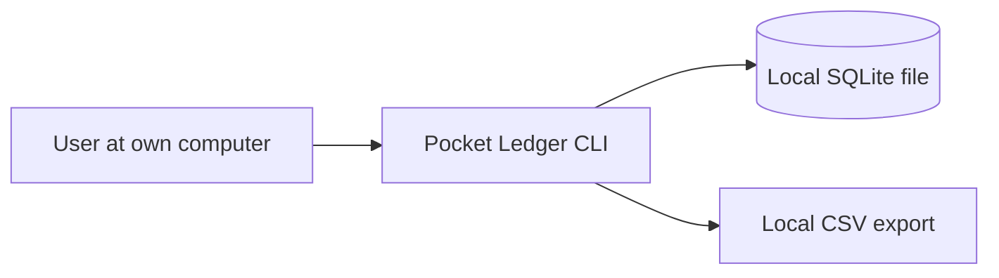

# DPDP engineering assessment report — Pocket Ledger

> Engineering assessment, not legal advice. Legal conclusions require qualified review. This report records what was inspected, changed and tested. It does not certify legal compliance.

Assessment date: 2026-10-29 · Repo ref: 4f1df18 (assessed); 969b962 (after change) · Assessed by: discovery, legal-mapping, privacy-engineering, implementation

## 1. Application overview

Open-source command-line expense tracker that each person installs and uses on their own computer to record their own expenses.

Scope of assessment: Whole repository (ledger/, tests/). Not inspected: distribution channel (package index page), any forks.

**Components**

| ID | Type | Tech | Location |
|---|---|---|---|
| C-01 | other | Python CLI + local SQLite file | user's own computer |

**Processing activities**

| ID | Activity | Purpose | Data | Recipients | Location | Facts |
|---|---|---|---|---|---|---|
| PA-01 | Personal expense tracking | The user records and totals their own expenses | DC-01 |  | user's device | confirmed |

**Data-flow map**

## 2. Applicability assessment and limitations

**Overall: not-currently-applicable** (confidence: high; legal review required: False)

The only processing (PA-01) is done by an individual on their own device for personal purposes, which Act s.3(c)(i) excludes. The author distributes code but never receives any data (verified: no network or telemetry code), so the author is not processing personal data of users. The author's statement (E-001) was tested, not relied on.

| Activity | Status | Lawful ground | Provisions | Confidence | Reasoning |
|---|---|---|---|---|---|
| PA-01 | not-currently-applicable | not needed (excluded) | Act s.3(c)(i) | high | Data never leaves the user's device and is processed by the individual for personal purposes. Notes about third parties are still within the user's personal/domestic processing. |

**Assumptions and unknowns (limitations)**

_None recorded._

## 3. Legal requirements considered and supporting evidence

| Req ID | Title | Provisions | Status | In force | Evidence | Required action |
|---|---|---|---|---|---|---|
| DPDP-SCOPE-03 | Statutory exclusions | Act s.3(c)(i), Act s.3(c)(ii) | not-currently-applicable | no (from 2027-05-13) | E-002, E-003 | none |

## 4. Identified gaps

Mandatory = legal gap against an applicable requirement. Everything else is a security, operational or optional improvement.

| ID | Req | Category | Mandatory | Severity | Priority | Title | Status |
|---|---|---|---|---|---|---|---|
| F-01 |  | security-vulnerability | False | medium | P2 | CSV export written to shared temp directory with default permissions | verified |
| F-02 |  | best-practice | False | low | P3 | Optional encryption of the local database | open |

## 5. Changes implemented

| Plan | Findings | Change | Approval |
|---|---|---|---|
| P-01 | F-01 | Default export path in the user's home, created with 0600 permissions | not-required |

**Planned but not implemented**

_None recorded._

## 6. Files and components modified

| Plan | Files | Commit |
|---|---|---|
| P-01 | ledger/core.py, tests/test_core.py | 6805e87, 969b962 |

## 7. Database migrations and infrastructure changes

_None recorded._

## 8. Tests executed and their actual results

| ID | Test | Command | Executed | Result | Independent | Output |
|---|---|---|---|---|---|---|
| T-01 | tests/test_core.py::test_export_default_is_private_and_not_in_temp (first version) | python3 -m pytest -q | True | fail | False | .dpdp/runs/2026-10-29-pytest-run1-test-bug.txt |
| T-02 | tests/test_core.py (3 tests) | python3 -m pytest -q | True | pass | False | .dpdp/runs/2026-10-29-pytest-implementation.txt |
| T-03 | new test against baseline ledger/core.py | git checkout 4f1df18 -- ledger/core.py && python3 -m pytest -q | True | fail | False | .dpdp/runs/2026-10-29-pytest-new-test-on-baseline.txt |

**No independent verification has been recorded.**

## 9. Outstanding risks and unresolved issues

| ID | Title | Severity | Status |
|---|---|---|---|
| F-02 | Optional encryption of the local database | low | open |

**Open legal questions**

_None recorded._

## 10. Items requiring legal, security or management approval

_None recorded._

## 11. Recommended next steps

- No DPDP work required while the facts below hold

**Reassess when:**

- Any network feature: cloud sync, backup to a server, crash reporting, analytics, update checks that send identifiers
- User accounts, shared ledgers or a hosted/web version (the author or an operator would then process users' data)
- The author offering paid support that involves receiving users' ledger files
- Use of the tool by an organisation for employees' or customers' expenses (no longer personal/domestic)

## 12. Traceability matrix (requirement → finding → plan → code → test)

| Requirement | Status | Finding | Plan | Files | Tests (result) | Finding status |
|---|---|---|---|---|---|---|
| DPDP-SCOPE-03 | not-currently-applicable / in force: no | — | — | — | — | — |

Rows without an executed passing test are not verified. A verified row means the control was implemented and tested, not that the legal requirement is met.
