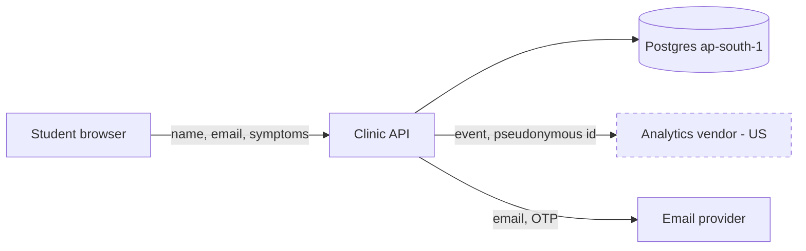

# Discovery guide (Phase A)

Goal: an inventory a reviewer can check line by line. Every fact gets an evidence reference. Everything else is an assumption or an unknown.

## Order of work

1. **Orient.** Read the README, docs, package manifests (`package.json`, `requirements*.txt`, `pyproject.toml`, `go.mod`, `pom.xml`, `*.csproj`, `Gemfile`, `composer.json`), the deployment files (`Dockerfile`, compose, k8s, Terraform, serverless, CI), and `.env.example`. Record the purpose, stack and deployment region.
2. **Run the scanner:** `scan_personal_data.py <repo> --out .dpdp/scan.json`. It flags field names, SDKs, AI providers, logging calls and existing controls. Confirm each relevant hit by reading the code. Hits in tests, fixtures and docs are weaker evidence.
3. **Data model.** Read the schema, migrations, ORM models, GraphQL/OpenAPI specs, protobuf and validators. List every field that relates to a person.
4. **Entry points.** Routes, controllers, handlers, forms, file uploads, webhooks, queues, cron jobs, CLI commands, admin panels and import scripts. For each one: what personal data comes in, from whom, and for what purpose.
5. **Exits.** Outbound HTTP clients, SDKs, email and SMS providers, analytics, error tracking, storage buckets, exports (CSV, PDF), webhooks out, and data shared with other internal systems.
6. **Identity and access.** Authentication method, session handling, role model, admin paths, service accounts, API keys, and object-level authorisation checks.
7. **Storage and lifecycle.** Databases, caches, search indexes, object storage, logs, backups, data warehouses and their retention settings. Check for soft-delete vs hard-delete and existing purge jobs.
8. **Existing privacy controls.** Consent fields and tables, privacy notice pages, cookie tooling, delete-account flows, data export, audit logs, encryption, masking, rate limiting. Record what exists **before** proposing anything.
9. **Tests.** What runs (`npm test`, `pytest`, `go test`, `mvn test`, `dotnet test`)? Run the suite once to get a baseline and record the result.

## Search patterns (adapt per language)

- Personal fields: `email|phone|mobile|name|dob|birth|address|pincode|aadhaar|pan|passport|gender|age|ip_address|device_id|location|lat|lng|photo|avatar|signature|salary|bank|ifsc|upi|account_no|health|diagnos|symptom|blood|prescription|roll_no|employee_id|student|parent|guardian`
- Logging of personal data: logger or print calls with those field names or whole request bodies (`req.body`, `request.json`, `JSON.stringify(user)`, `f"{user}"`).
- Deletion: `delete|destroy|remove|purge|erase|anonymi|soft_delete|deleted_at|is_active`.
- Consent and notice: `consent|opt_in|optin|marketing|terms|privacy|notice|cookie|gdpr|dpdp|withdraw|unsubscribe`.
- Access control: `role|permission|authorize|authorise|isAdmin|owner_id|user_id ==|policy|guard|middleware`.
- Children: `minor|child|under_18|age <|parent_consent|guardian|school|class|grade|student`.

## AI systems

Extra items to inventory when the application uses models:

- **Model providers:** which API (OpenAI, Anthropic, Google, Azure, self-hosted), region, and whether personal data goes into prompts. Check the provider's data-retention and training settings where the code or config sets them, and record unknowns otherwise.
- **Conversation history:** where it's stored, for how long, who can read it, and whether erasure reaches it.
- **Embeddings and vector stores** (Pinecone, Weaviate, Qdrant, Chroma, pgvector, FAISS): which source documents are embedded, whether chunks contain personal data, and whether vectors can be deleted per user or document. Erasure must reach them.
- **RAG sources:** document stores ingested, and whether they contain other people's personal data.
- **Fine-tuning or evaluation datasets** built from user data.
- **Automated decisions:** outputs used to make decisions about people. These trigger s.8(3) accuracy, and if the organisation is an SDF, r.13(3) algorithmic due diligence.
- **Tool-calling agents** that can read or send personal data. Check authorisation scope.

## Data-flow map

Draw a Mermaid flowchart: sources → components → stores → recipients. Label each edge with the data categories and mark processors and cross-border edges. Example:



## Recording facts

```yaml
evidence:
  - id: E-012
    type: code            # code | config | schema | infra | test-run | doc | interview | legal-opinion | notification
    ref: "src/routes/users.ts:41-58"
    summary: "POST /users stores name, email, phone, dob; marketing_opt_in defaults to true"
    trust: verified       # verified | reported | inferred | agent-claim
    collected_by: discovery-agent
    date: 2026-10-29
```

Good evidence references let another agent reopen the exact lines. Take line numbers from a read of that single file. `cat -n a b` numbers both files as one sequence, so every line cited in the second file comes out wrong (this happened in the benchmark pilot). Don't paste personal data, secrets or production records into `summary`. Describe them instead ("contains real email addresses").
